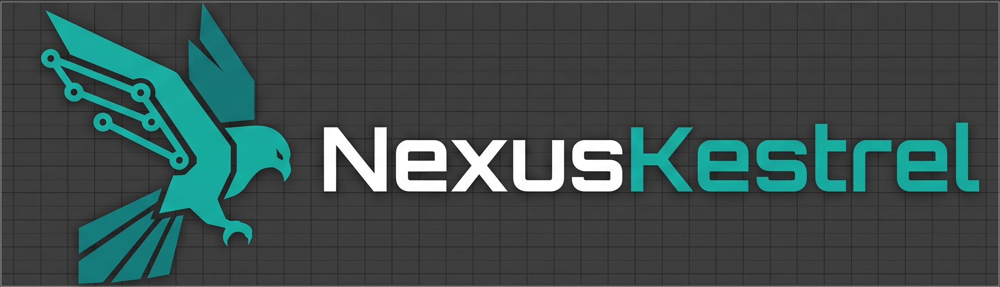

  

  <h1>NexusKestrel</h1>

  
<strong>Mini-JACE, protocol gateway and equipment controller: a small, secure field controller for building automation, in pure Rust on a single microcontroller.</strong>

  
  
  
  
  
  
  
  
  
  
  
  
  
  
  
  
  
  
  
  
  
  

  [What it is](#what-it-is) ·
  [Protocols](#protocols) ·
  [Local control](#local-control) ·
  [Fault detection](#fault-detection-and-continual-learning) ·
  [Security](#security) ·
  [Hardware](#hardware) ·
  [Licensing](COMMERCIAL.md)

---

This is the public **product, documentation, and legal** home for NexusKestrel. The
firmware is designed and built in-house by AutomataNexus, LLC, and its source is
private; this repository holds no code. It contains the product description, the
license, the end-user license agreement, the terms, and the privacy, security, and
safety policies.

## What it is

Kestrels are the smallest falcons. They hover over one patch of ground and work it.

The NexusKestrel fills the role of a **mini-JACE**. It talks to equipment and building
systems over the field protocols used in our industry, runs the same control sequences
as our NexusEdge controllers, monitors its equipment for faults, and reports to the
NexusEdge Console. It does all of this on one low-power microcontroller, with no
Rockwell or Tridium licensing and no third-party runtime.

| Use | What it does |
|---|---|
| **Protocol gateway / supervisor** | Reads and writes BACnet, Modbus, Allen-Bradley PLCs, Niagara stations, and legacy trunks, and brings those points into the Console. This is how we take over a Niagara or other aging front end. |
| **Point controller** | Sensors, valves, dampers, relays, and drives are wired to it and it runs the unit locally, with the Console supervising. |
| **Integration bridge** | Presents a unit to a customer's existing BAS as a native BACnet or Modbus device. |

Each Kestrel is built for its job. Only the boards that unit needs are fitted, and its
firmware image carries only the sequences that unit runs. A different sequence later
is a signed over-the-air update of about a minute.

## Protocols

| Protocol | What the Kestrel does |
|---|---|
| **BACnet MS/TP** | Full BACnet device on either RS-485 port; MS/TP master and client that reads and writes other devices at a set priority, each write read back |
| **BACnet/IP** | Full BACnet device (UDP 47808, on Ethernet, Wi-Fi or both); supervisory client for routed BACnet networks. Off until enabled for a job, so a writable device never appears on a customer LAN unannounced |
| **Modbus RTU** | Slave on RS-485 #1 for a CM5 or BAS; master on RS-485 #2 for drives, meters, and boilers. Built-in ABB ACH580 / ACS580 / ACS550 drive profiles plus a generic profile |
| **Allen-Bradley PLCs** | MicroLogix 1100 / 1400 and SLC 5/05 over EtherNet/IP, using RSLogix addresses (N7:0, B3:1/0, T4:0.ACC, O:0/2). PLC mode and fault code monitored and logged |
| **Niagara AX / N4** | Through the station over oBIX (JACEs and FX80s, using the station's watch service so the front end barely notices), or under it, directly on the field trunk |
| **Niagara R2 (UNC-510)** | Reads points over HTTP and writes analog outputs through the station's own command interface, each write read back |
| **Siemens APOGEE** | Supervisor of APOGEE field panels over P2 |
| **Johnson Controls N2** | Decodes the trunk's polls and replies, so N2 points are read without disturbing the existing system; can ask each address whether a device is present |
| **LonWorks FT-10** | Reads and writes LON devices directly: decodes network variables and sends updates as its own node on the channel (Trane Tracer ZN fan coils and other LonMark devices) |
| **Carrier CCN** | Reads Carrier equipment directly as a CCN master |
| **Trane Comm4** | Reads Trane Comm4 unit controllers and writes their occupied / unoccupied heating and cooling setpoints, each write read back; stays off the trunk whenever another Comm4 master is active |
| **Staefa SMART II / NCRS** | Connects to the Staefa front end and commands its digital points |

**Trunk identification.** Pointed at an unknown RS-485 trunk, the Kestrel listens and
reports what it hears (N2, CCN, Siemens P1/FLN, MS/TP or Comm4) and why.

**Integration sheet.** The Kestrel generates its own integration documents: identity,
addresses and port settings, the full BACnet object list with units and current values,
an **EDE file** for the front end's BACnet import, and the Modbus map.

**Every command is read back.** Whether a command comes from the Console, the service
shell, Modbus, BACnet, or the Kestrel's own control, it is reported as **confirmed**,
**FAILED**, or **unconfirmed**, and is only reported complete when the read-back
confirms it.

## Local control

The Kestrel runs **Talos**, the same control engine as our CM5 and NexusEdge
controllers. Every Talos equipment sequence is ported with its logic unchanged and its
full test suite, so a Kestrel runs a unit exactly the way the CM5 beside it would.

**69 equipment sequences**, by family:

| Family | Sequences |
|---|---|
| Air handlers | TMC AHU · TMC AHU + Exhaust Damper · TMC AHU (Cooling-only) · TMC AHU 4-pipe Lead/Lag · TMC Zone AHU · TMC DX AHU · DX + CW AHU · TMC Make-Up Air · TMC Steam AHU · Rooftop Unit |
| Dedicated outdoor air | TMC Direct-Fired DOAS + DX · TMC DOAS + DX + Season Relay · DOAS Gas Heat + 2-Stage DX · DOAS Permissive |
| Zones and terminals | Fan Coil Unit (2-Way / 4-Way) · Classroom Unit Ventilator · TMC VAV · TMC VAV + DX · Zone Reheat · TMC Electric Heat · Heat Pump |
| Chillers, towers, geothermal | TMC Chiller · TMC Chiller (simplified) · TMC Chiller RTAA · TMC Chiller Plant · Water-Cooled Chiller · Chiller Remote Enable · Lead/Lag Chillers · Cooling Tower · TMC Geo Stage · TMC Seasonal Changeover |
| Boilers and steam | Lead/Lag Boiler · Cascade Boiler Plant · Cascade Boiler Plant (Lochinvar PowerFin) · TMC Domestic Boiler · TMC Comfort Boiler · Steam-Boiler Safety Monitor · TMC Steambundle · TMC Steam Reset |
| Pumps and loops | VFD Pump Pack · Lead/Lag Pumps · TMC Loop Pump Plant · TMC Circulator Pump · TMC Lead/Lag Enable · Pressure Booster Pumps · Pressure Booster Pumps (DP Proof) |
| Pools and natatoriums | Natatorium PoolPak · TMC Natatorium · TMC Natatorium AHU · Pool Controller (Heat Pump) · Pool Controller (Gas Heater) |
| Greenhouses | TMC Greenhouse · TMC Greenhouse Plant |
| Residential | Residential Furnace · Residential Heat Pump · Residential Boiler · Smart Home Controller · Smart Garden |
| Lighting and monitoring | Commercial Lighting · Electrical Load Monitor · Water Monitor (City) · Water Monitor (Well) |
| General-purpose loops | PID · Linear Proportional · On/Off · Cascade · TMC · Always-On Enable · Model Predictive Control (advisory) |

- **Custom logic from NexusFoundry.** Technicians open any sequence as a wire sheet of
  logic blocks, modify it or build new logic, test it in the live simulator by tripping
  safeties and alarms, and export it, once it passes Foundry's verification gates and
  is signed, as a native sequence for the Kestrel.
- **Point assignments.** Each sequence input is assigned to a point, a combination of
  points, or a scaled reading (for example loop DP = AI 1 × 20 − AI 2 × 20, or a high
  limit built from a supply sensor). A sensor that is not reading is treated as
  missing; the sequence never substitutes a value.
- **Life safety.** Every sequence honors the safety inputs it uses (smoke, fire alarm,
  freeze stat, flow, high limit, airflow proof, damper end switch), all normally
  closed. A failed sensor opens its limit and trips; it never reads as safe.
- **Hand and overrides.** An output placed in hand from the Console, the shell, Modbus
  or a BACnet priority write is left alone until released, and the sequence resumes
  smoothly. Relays keep a minimum off time, including after power-up, so a reset
  cannot short-cycle a compressor.
- **Plant templates.** Tested configurations for common plants, such as lead/lag
  boilers with outdoor-air reset and lead/lag loop pumps on differential pressure, and
  classroom unit ventilators, filled in per site.
- **Settings change live**, one at a time or as a signed settings bundle, with no
  rebuild and no restart. Sequences on a local schedule use the site's local time.

## Fault detection and continual learning

Every Kestrel can carry its own fault detector, and it keeps learning in the field.

The models are built with **Oxiryn**, our bare-metal machine-learning framework: the
bare-metal port of **[AxonML](https://github.com/AutomataNexus/AxonML)**, our in-house
AI / ML / LLM framework written in Rust. AxonML trains at scale on GPUs; Oxiryn is the
separate framework that trains and runs the same kind of models where there is no
operating system, no allocator, and a few hundred kilobytes of memory. Both are
AutomataNexus's own.

### The detector

- **One model per unit.** Each piece of equipment gets its own model, trained on **that
  unit's own operating history** and on faults generated from that unit's own measured
  operating law: how it stages, cycles, and responds to its setpoint and the weather. No
  two units share a model, and no model is a generic equipment-class template.
- **Small enough for a microcontroller.** The network is trained in Oxiryn,
  quantization-aware, and packed to 4-bit weights (about 11 KB). It reads a two-hour window of the unit (8 ticks
  of 9 signals, with outdoor air from the site's weather feed) and has two heads: an
  anomaly score and a fault class.
- **Names the fault.** For a water-source heat pump the classes are normal, capacity
  loss, short cycling, compressor stuck on, compressor fails to start, fan interlock
  failure, and reversing valve stuck. Each equipment type has its own fault set.
- **Runs on the Kestrel's own processor**, with no accelerator and no cloud round trip.
  It scores the unit every 3 minutes; three abnormal scores in a row raise a flag in the
  Console with the fault class and anomaly score. A light on the board shows while it
  scores.
- **Gated before it ships.** A model is accepted only if it stays quiet on held-out
  healthy history and catches the injected faults. The first production unit's model
  flagged 0 % of held-out healthy windows, with 97 % fault recall and a 2.5 % false-alarm
  rate.

### Continual learning on the device (Scholar)

The Kestrel adapts its detector to its unit while it runs: a sensor that drifts, a
season that changes the load, a unit that ages. This is the microcontroller port of the
continual learning that runs on our larger controllers.

- **Control always wins.** Training runs only in leftover time: one sample per pass,
  every 250 ms, and only while control has headroom (no field-bus write waiting, the
  chip running cool). A pass holds the processor for about 1-2 ms and yields the moment
  control needs it.
- **Learns on the board.** Nanobatch gradient descent on a full-precision shadow of the
  4-bit model, with the deployed model's quantization scales frozen, so a candidate
  re-packs into exactly the format the detector runs. About 88 KB of memory; no
  allocator, every buffer fixed-size.
- **Remembers what it was taught.** It trains from the unit's labeled install data and
  replays it as it adapts, so learning a new normal does not erase the faults it already
  knows.
- **Survives power loss.** Training checkpoints regularly and resumes after a reboot or
  outage instead of starting over.
- **Checked twice before it is used.** On a schedule (every 24 hours by default), a
  candidate must first beat or match the current model on the board's own test fixtures.
  It then goes to the AutomataNexus server, which re-judges it against the model the
  unit was commissioned with: same format and scales, no more than 30 % of the weights
  moved, right on at least as many labeled cases, and no new false alarm on normal
  operation. Only then does the server sign it, with a signature bound to that one
  controller.
- **Only signed models run.** The Kestrel verifies the signature, writes the model to
  the spare of two model slots in flash, reads it back, and serves it. At every start it
  serves the newest slot whose checksum, signature, and format all hold, or else the
  model it shipped with. A rejected, unsigned, or unverified candidate is discarded and
  the unit keeps the model it has.
- **Visible in the Console.** Learning phase, steps, loss, the model version in service,
  and when it was last signed are reported with the detector's verdicts.

## Capacity

| Limit | Per Kestrel |
|---|---|
| Supervised devices and points (supervisory image) | 160 devices / 4,096 points, from a point table in flash |
| Equipment under local control at once | 16, each with its own sequence, parameters, and inputs (8 with on-device learning running) |
| Field points | 128, shared by all equipment and the BACnet / Modbus mirrors |
| BACnet objects | 192, with 16-level priority arrays and change-of-value subscriptions |
| Inputs per sequence | 32 named inputs, 32 outputs |
| Settings | 16 KB, kept as two alternating copies in flash; changes take effect live |
| Control pass | every 2 seconds, using a small fraction of the processor's time |

## The NexusEdge Console

The Kestrel connects **outbound only** to the NexusEdge Console over TLS 1.3, verifying
the server against our own certificate authority built into its firmware. It sends
status and readings every 30 seconds and checks for commands every 5 seconds. It uses
wired Ethernet when present and falls back to Wi-Fi automatically.

Each unit the Kestrel runs appears in the Console as its own equipment, with the same
field names as every other controller in the fleet, so a Kestrel's boilers and pumps
sit beside a CM5's on the same pages and alarms.

## Security

Security is layered from the chip up, and each layer holds even if another fails.

### Secure boot and signed everything

- **Secure boot.** Each chip's one-time-programmable memory holds the fingerprint of the
  AutomataNexus signing key. The boot ROM checks the firmware's signature at every start
  and runs nothing else; the signing key never leaves our build machines. Altered
  firmware will not start, and a flash dump copied to another board will not start there.
- **Signed partition table.** Both firmware slots must carry our signature, so an update
  cannot add anything we did not sign.
- **A/B signed updates with automatic rollback.** Every block of an update is checked
  (framing, family, numbering, target partition, contiguity), the whole stream's SHA-256
  must match, the written range is read back and hashed again, and the boot ROM verifies
  the signature. The new image runs on trial and keeps itself only once it proves
  healthy; if it does not within five minutes, or it crashes or hangs, the previous image
  boots again. Updates travel compressed.
- **Signed settings.** Settings bundles carry an Ed25519 signature bound to one specific
  Kestrel; a bundle for one unit is refused by every other, and an unsigned bundle is
  refused outright. The whole bundle is validated against the control schemas before
  anything is saved, in one write, so a bad bundle changes nothing.
- **Signed models.** A fault model runs only with the server's signature for that
  controller (see *Continual learning*).

### Identity and network

- **Per-device identity.** Every Kestrel carries its own key, accepted by the Console only
  for that controller: its readings, its status, its commands, and the unit it watches.
  A lost or retired unit is shut out by revoking its key, with no effect on any other.
- **Outbound only.** The Console link is TLS 1.3, and the server must chain to our own
  device certificate authority, pinned in the firmware. The Kestrel will not talk to a
  server impersonating the Console.
- **No internet-facing services.** Remote service, updates, and settings run only inside
  our own peer-authenticated WireGuard mesh and answer only approved addresses; anything
  else is refused and counted. The only other listeners are the field protocols a job
  turns on, and BACnet/IP is off by default.
- **Encrypted direct link on site.** For a LAN with no internet, our own protocol on
  vetted primitives (X25519, Ed25519, ChaCha20-Poly1305, HKDF-SHA256). The device proves
  its identity in the handshake; the technician's laptop must be an enrolled Ed25519 key
  and signs the session transcript. Each direction has its own key and a counter nonce,
  so a replayed, reordered, or altered message ends the session, and ephemeral keys give
  forward secrecy. With no laptop enrolled, every attempt is refused.

### NexusShield on the Kestrel

NexusShield, our zero-trust security platform, ported to the microcontroller (`no_std`,
no allocation, host-tested). Every write from every source (the Console, the service
shell, Modbus, BACnet, and the Kestrel's own control) passes through it.

- **Tamper-evident audit chain.** Every write, refusal, settings change, update, model
  change, reboot, fail-safe event, and operator session is recorded in a SHA-256 hash
  chain, each entry sealed to the one before it. The head of the chain (sequence and
  hash) is reported to the Console with every push, so a rewritten or truncated history is
  detected.
- **Write governor.** A change budget per output per minute and a relay minimum off time,
  enforced from power-up, so no source, ours included, can chatter a contactor or
  short-cycle a compressor. Re-writing the same value is free.
- **Bus threat scoring.** On the Modbus and BACnet field interfaces, CRC storms,
  exception probing, illegal functions and addresses, and write floods raise a decaying
  threat score. At the threshold that bus's writes are refused for 10 minutes while its
  reads keep answering, so a misbehaving master stays visible.
- **Two rules always apply.** Turning an output **off** is always allowed, because off is
  the safe direction. And our own Console and service access is never banned, because
  losing access to a field device is a greater risk than the attacks a lockout would
  prevent.

### Hardened firmware

What ships is a signed image in flash. The realistic attack is a flash dump and reverse
engineering, so the image is built to make a dump hard to get and useless once taken.

- **Secrets obfuscated at rest.** Device secrets are masked with a per-build random pad
  and decoded only into a stack buffer at the moment of use. A search of a memory dump
  finds none of them.
- **Nothing to read.** No symbol table, no source file paths, no panic or error-message
  text in the shipped image.
- **Nothing to follow.** Size-optimized, fat link-time optimization, and a single code
  unit, so the control flow does not map back to the source.
- **Hardware stack guard.** The processor's stack limit register is set at reset; an
  overflow faults and resets cleanly instead of corrupting memory, and an image on trial
  rolls back.
- **Fail-safe outputs.** Outputs power up off / 0 V. If no supervisor is heard for 15
  minutes while outputs are commanded, they return to off / 0 V (with local control
  running, only outputs placed in hand are released). Boards that brown out are restored
  to the commanded state on the next pass.
- **Chip lock-down.** For the highest-security installations, the debug port and the boot
  ROM's USB read-back path are permanently disabled in one-time-programmable memory, a
  deliberate step in our workshop on a verified unit. With secure boot on and debug off, a
  flash dump is both very hard to obtain and of no use.
- **Audited and tested.** Every crate is checked with `cargo audit`, and the firmware, its
  tools, and its Console endpoint have been through our own penetration-testing tool
  (NexusProbe) with no exploitable finding.

See [SECURITY.md](SECURITY.md) to report a vulnerability.

## Hardware

One board, no modules, no hand wiring, built for the panel.

| Item | Specification |
|---|---|
| Processor | Raspberry Pi RP2350B, dual Hazard3 RISC-V cores, 520 KB SRAM, hardware TRNG, OTP key storage |
| Flash | 16 MB QSPI, A/B firmware partitions, two settings sectors, two signed model slots |
| Wireless | Raspberry Pi Radio Module 2, 2.4 GHz Wi-Fi (802.11n), its own FCC modular grant |
| Wired network | 10/100 Ethernet (W5500), DHCP; preferred over Wi-Fi when present |
| RS-485 | Two ports, each independently Modbus RTU, BACnet MS/TP, or a legacy trunk; **termination and bias switched in software** |
| LonWorks | FT-10 transmit and receive on board (FT-X3 transformer), transmit gated by a jumper |
| Analog inputs | 16, 16-bit, each set per channel: 0-10 V, 0-5 V, or 4-20 mA |
| Analog outputs | 8, 0-10 V, 12-bit |
| 24 VAC outputs | 8 triac outputs (zero-cross optically isolated), two banks with their own 24 VAC commons, LED per output |
| Digital inputs | 8 dry contacts |
| Temperature | 4 precision 10K Type II inputs on precision excitation; DS18B20 1-Wire pipe / air sensors |
| Other sensors | Any 0-10 V, 0-5 V, or 4-20 mA transmitter (temperature, humidity, pressure, CO2, current, flow), duct differential pressure and others on Qwiic / STEMMA-QT I2C, PIR occupancy |
| Network sensors | Any sensor on BACnet, Modbus, LonWorks, N2, or another supported protocol, such as a BACnet room stat's temperature, humidity, setpoint, and occupancy, used by local control like a wired input |
| Power | 24 VAC/DC (either polarity) or 5 V, diode-ORed; USB-C service port |
| Protection | Surge, spike, and noise protection at every terminal (TVS, MOV, PTC fuses on every rail with rail monitoring, RS-485 surge clamps, Ethernet line protection); analog inputs survive 24 VAC miswired to them |
| Terminals | WAGO lever (push-in CAGE CLAMP) terminals in two straight labeled rows, 26-16 AWG |
| Board / enclosure | 170 x 100 mm, black solder mask, ENIG; TS35 DIN-rail enclosure with terminals and labels left open |

**Status light.** A repeating blink code shows heartbeat, Console data, traffic,
Ethernet, and Wi-Fi at a glance, even with the network down. A second light is lit
while the fault model scores.

## Licensing and purchase

NexusKestrel is proprietary hardware and firmware from AutomataNexus, LLC, installed
and commissioned by our controls technicians or authorized partners. See
[COMMERCIAL.md](COMMERCIAL.md).

| Document | |
|---|---|
| [LICENSE](LICENSE) | Copyright and license notice |
| [EULA.md](EULA.md) | End User License Agreement for the firmware |
| [TERMS.md](TERMS.md) | Terms of Service |
| [PRIVACY.md](PRIVACY.md) | What the device and the Console collect |
| [SECURITY.md](SECURITY.md) | Vulnerability reporting and disclosure |
| [SAFETY.md](SAFETY.md) | Safety notice and intended use |
| [TRADEMARKS.md](TRADEMARKS.md) | Trademarks and third-party marks |
| [COMMERCIAL.md](COMMERCIAL.md) | Purchasing, licensing, and support |
| [CHANGELOG.md](CHANGELOG.md) | Release notes |

## Contact

**AutomataNexus, LLC** · Wolcottville, Indiana, USA

- Sales and integration: [devops@automatanexus.com](mailto:devops@automatanexus.com)
- Security: [security@automatanexus.com](mailto:security@automatanexus.com)
- Legal: [legal@automatanexus.com](mailto:legal@automatanexus.com)
- Web: [automatanexus.com](https://automatanexus.com)

---

**© 2026 AutomataNexus, LLC.** All rights reserved.
NexusKestrel, NexusEdge, NexusShield, NexusFoundry, Talos, Oxiryn, and AxonML are trademarks of AutomataNexus, LLC.

